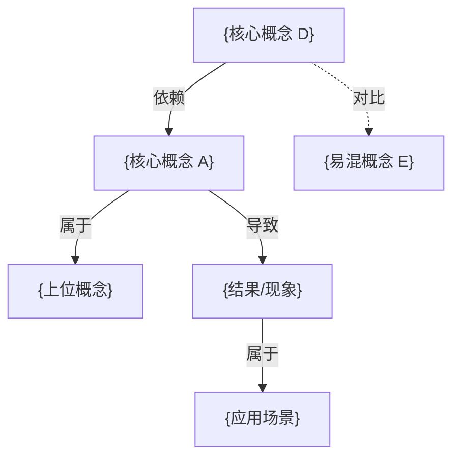

# 知识图谱 · {主题}

> 铁律：这张图必须**学习者本人画**。AI 只做检查，不代笔。

## 一、画图规范
<!-- section:rules -->

- **节点** = 一个概念，用名词；一个节点只写一个概念，不写句子。
- **边** = 关系，必须标注类型：`属于` / `导致` / `依赖` / `对比`。
- 一个节点只能有**一个主父级**；跨分支的关系用虚线单独标。
- 层级不超过 **4 层**；超过说明拆分粒度错了。
- 中心位只放**骨架概念**（能撑起整个领域的那些），细节挂在末端。

## 二、图谱（Mermaid 骨架，改成你的内容）
<!-- section:map -->

> 手写拍照也可以，把照片里的要点转成上面的结构再检查。

## 三、四类错误自检（画完先自己查一遍）
<!-- section:self-check -->

| 类别 | 检查问题 | 有 / 无 | 说明 |
|------|---------|--------|------|
| 漏节点 | 骨架概念是否都在中心区域？有没有核心概念只挂在边角？ |  |  |
| 方向错 | 每条因果/依赖边的方向，反过来读一遍还成立吗？ |  |  |
| 层级错位 | 并列的东西被写成父子了吗？父子被写成并列了吗？ |  |  |
| 循环 | 是否存在 A 靠 B 定义、B 又靠 A 定义？ |  |  |
| 同义反复 | 有没有用同义词解释自己（如"并发就是同时进行")？ |  |  |

## 四、AI 检查记录
<!-- section:ai-check -->

| # | 可疑的边/节点 | AI 的追问 | 我的回答 | 判定 | 改法 |
|---|--------------|----------|---------|------|------|
| 1 |  |  |  | 对 / 错 |  |
| 2 |  |  |  |  |  |

## 五、仍然模糊的点
<!-- section:fuzzy -->

1. 
2. 
3. 

> 这 3 个点直接变成下一轮回测的题目来源。

## 六、回测
<!-- section:retest -->

> 一轮 5 题。答错要补时**不要覆盖旧行**——在下面追加 5 行，轮次写 2、3……
> 覆盖旧行等于抹掉「连错」记录，`stage.py` 就判不出你该重定靶了。
>
> **「概念」列必填**：这是这个概念进入复习队列的唯一凭据。查不到概念名的题，
> 答对也排不进复习，等于白测（`stage.py check` 会拦）。
> **「信心」列在答题前填**：你觉得自己能答对的把握，1=完全没底，5=很有把握。
> 事后拿它和实际结果比，才知道你是高估还是低估了自己。

| 轮次 | # | 概念 | 题（应用题） | 信心 1-5 | 结果（对/勉强/错） | 备注 |
|---|---|---|---|---|---|---|
| 1 | 1 |  |  |  |  |  |
| 1 | 2 |  |  |  |  |  |
| 1 | 3 |  |  |  |  |  |
| 1 | 4 |  |  |  |  |  |
| 1 | 5 |  |  |  |  |  |

通过线：**本轮**答对 ≥4（「勉强」算过，但会拿到更短的复习间隔）。

> 答错只补对应那一个概念。补的时候跑 `stage.py retry <会话目录> --concept "概念名"`：
> 它会退到第 3 阶、把该概念的动作重新置为未完成（清空产物），你重做完再一路 advance 回第 5 阶。
> 同一个概念连续 2 轮都答错 → `stage.py check` 会拦住，并要你跑 `stage.py reset` 回第 0 阶重新定靶。

**下一轮复习日期**：______

> 这一轮过了只是「当场会」。之后每天跑 `coach.py today <会话目录>`，
> 到期就用 `coach.py recall` 做无提示召回。两个不同日子都想得起来，才是「已掌握」。

> 闭环通过时 `stage.py` 会按每个概念各自的遗忘曲线算出复习日，
> 写进这一行和 00-plan.md 的复习表。到日子跑 `stage.py review <会话目录>`。
